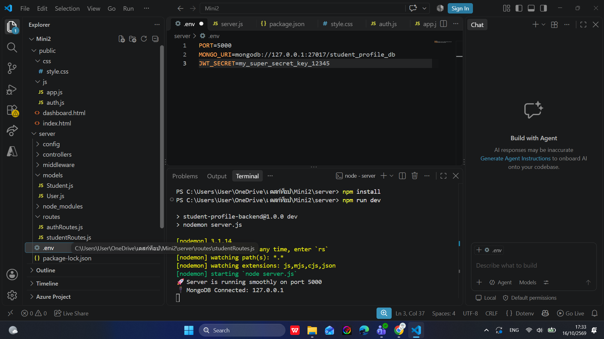
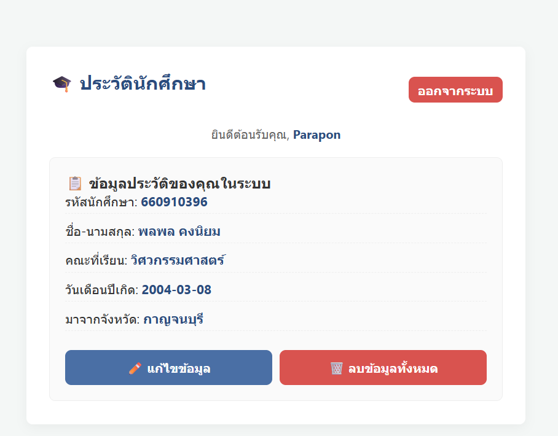

# 🎓 ระบบจัดการข้อมูลประวัตินักศึกษา (Student Profile Management System)

เว็บแอปพลิเคชันขนาดเล็กสำหรับจัดการข้อมูลประวัตินักศึกษา พัฒนาในรูปแบบ Full-Stack (Node.js + Express และ HTML/CSS/JS ธรรมดา) เชื่อมต่อกับฐานข้อมูล MongoDB รองรับระบบยืนยันตัวตน (Authentication) เพื่อความปลอดภัยของข้อมูล

---

## 📂 โครงสร้างโปรเจกต์ (Project Structure)
โปรเจกต์จัดโครงสร้างแยกฝั่งเซิร์ฟเวอร์และฝั่งไคลเอนต์ออกจากกันอย่างชัดเจนใน Repository เดียวกัน:
- `/server` : ฝั่งหลังบ้าน (Backend Server) พัฒนาด้วย Node.js, Express, Mongoose
- `/public` : ฝั่งหน้าบ้าน (Frontend Client) พัฒนาด้วย HTML, CSS (สไตล์โมเดิร์น), JavaScript Fetch API

---

## 🛠️ วิธีการติดตั้งและการรันระบบ (Installation & Running)

### 💻 1. การตั้งค่าฝั่ง Server
1. เปิด Terminal แล้วเข้าไปที่โฟลเดอร์ `server`:
   ```bash
   cd server
   ```
2. ติดตั้ง Library และ Dependencies ทั้งหมด:
   ```bash
   npm install
   ```
3. สร้างไฟล์ `.env` ไว้ในโฟลเดอร์ `server/` และตั้งค่าดังนี้:
   ```env
   PORT=5000
   MONGO_URI=mongodb://127.0.0.1:27017/student_profile_db
   JWT_SECRET=my_super_secret_key_12345
   ```
4. เริ่มต้นรันเซิร์ฟเวอร์ในโหมดพัฒนา (Development Mode):
   ```bash
   npm run dev
   ```

### 🌐 2. การใช้งานฝั่ง Frontend
- สามารถเปิดใช้งานหน้าเว็บได้โดยการคลิกขวาที่ไฟล์ `public/index.html` แล้วเลือก **Open with Live Server** ใน VS Code หรือดับเบิ้ลคลิกเปิดไฟล์ผ่าน Web Browser ได้ทันที

---

## 📌 รายการเส้นทาง API (Endpoints)

### 🔑 1. ระบบผู้ใช้และการยืนยันตัวตน (Auth Routing)
- **POST** `/api/auth/register` : สมัครสมาชิกใหม่ (ลงทะเบียนผู้ใช้)
- **POST** `/api/auth/login` : เข้าสู่ระบบ (รับ Token บัตรผ่านทาง)

### 🎓 2. ระบบจัดการข้อมูลประวัตินักศึกษา (Student Routing - ต้องแนบ JWT Token)
- **POST** `/api/student/profile` : เพิ่มข้อมูลประวัตินักศึกษาใหม่ (Create)
- **GET** `/api/student/profile` : เรียกดูข้อมูลประวัตินักศึกษา (Read)
- **PUT** `/api/student/profile` : แก้ไข/อัปเดตข้อมูลประวัตินักศึกษา (Update)
- **DELETE** `/api/student/profile` : ลบข้อมูลประวัตินักศึกษาออกจากระบบ (Delete)

---

## 📸 ภาพหลักฐานการดีบักระบบ (Debugging Evidence)

### 1. ภาพหลักฐานการดีบักฝั่งเซิร์ฟเวอร์ (Backend Debugging)
*(แสดงผลการเชื่อมต่อฐานข้อมูล MongoDB สำเร็จ และเซิร์ฟเวอร์รันบนพอร์ต 5000)*


### 2. ภาพหลักฐานการดีบักฝั่งไคลเอนต์ (Frontend Debugging)
*(แสดงหน้าจอ Dashboard หลังจากผู้ใช้กดบันทึกข้อมูลประวัตินักศึกษาสำเร็จ)*

